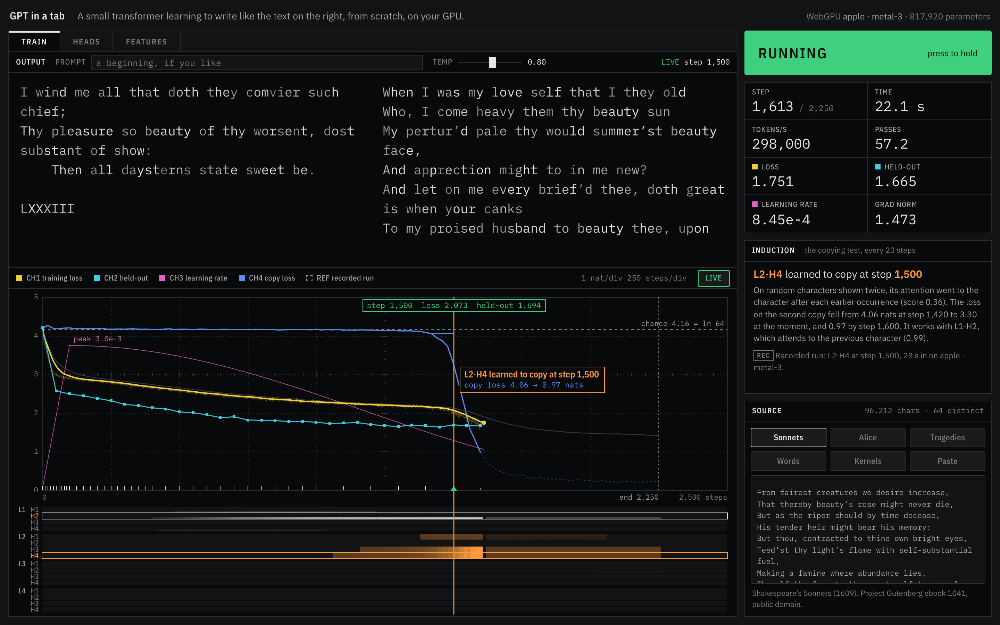
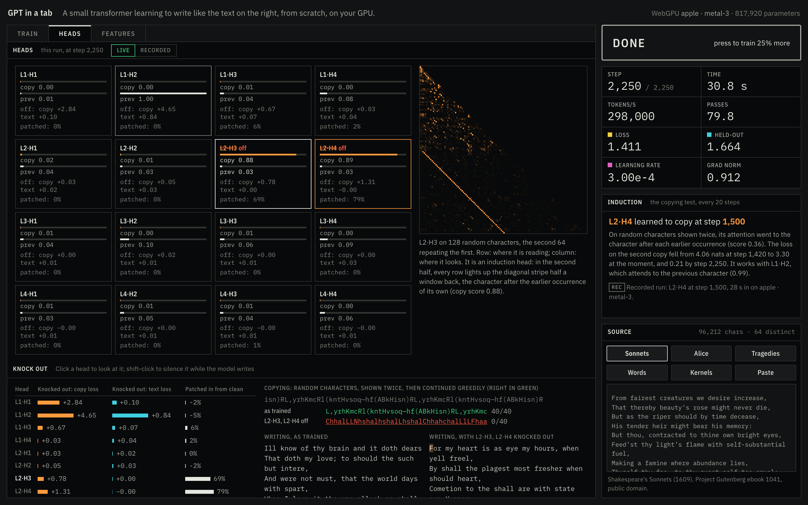
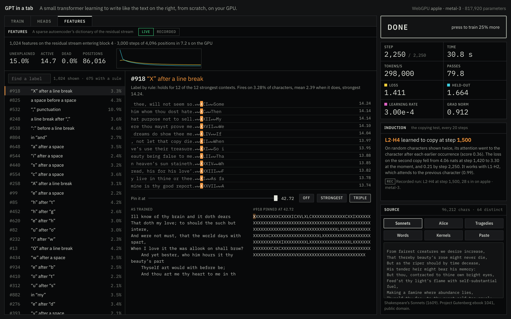
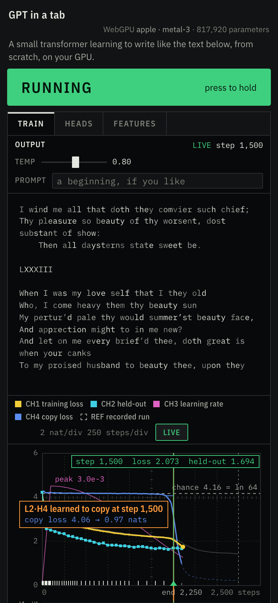

# GPT in a tab

[](https://harryfreeman.dev)

A small transformer trains in your browser, on your GPU, on hand-written WebGPU kernels. In
under a minute you watch the moment it learns to copy. Then you take it apart: knock out heads,
patch activations between runs, and read its residual stream through a sparse autoencoder that
is also trained on the GPU. There is no server, no model download and no machine-learning
library. The model you dissect is the one you just trained, and every result is measured, not
illustrated. The mechanisms come from interpretability research. Here they form, and you can test
them causally, in an ordinary browser tab.



## Try it

```sh
git clone https://github.com/Hfreeman2025/gpt-in-a-tab
cd gpt-in-a-tab
npm ci
npm run dev        # local only: serves the page at http://localhost:5173
```

- **Network:** only `npm ci`. The page fetches nothing from anyone else: the texts, the fonts and
  the recorded run are all served with it.
- **Local resources:** a browser with WebGPU and a GPU trains the full model. That means current
  Chrome or Edge, or Safari 26. Training takes about 30–40 seconds on an Apple laptop GPU.
- **Fallback:** without WebGPU (Firefox today, many phones) a smaller model trains on the CPU in
  a worker. The microscope then shows the recorded GPU run, labelled as recorded.
- **Recorded weights:** `public/recorded/weights.bin` is not in the repository. Model weights stay
  out of git. `npm run record` writes it: it trains this code in headless Chromium, so it needs
  `npx playwright install chromium` and a GPU. Without the file, the page offers the recorded
  model's download and shows it failing. Everything else still works.
- **Address options:**
  - `?cpu` forces the fallback.
  - `?text=alice|tragedies|words|kernels` picks another text.
  - `?hold` loads the page without starting a run.

`npm run build` writes a static site to `dist/`.

| check | command | where it runs |
| --- | --- | --- |
| types, lint, formatting | `npm run typecheck`, `npm run lint`, `npm run format:check` | CI and locally |
| CPU reference (48 tests) | `npm test` | CI and locally |
| dependency licences, audit, build | `npm run licences`, `npm audit`, `npm run build` | CI and locally |
| every GPU kernel against the CPU reference | `npm run test:gpu` | locally only: needs a GPU with WebGPU, which GitHub's runners lack |
| the page's lifecycle and the microscope, in Chromium | `npm run test:ui` | locally only, same reason |
| Chromium, WebKit and Firefox, one at a time | `npm run test:browsers` | locally only, same reason |
| layout shift, timings, screenshots | `npm run cls`, `npm run perf`, `npm run shots` | locally only |

## How it works

**The model.** A character-level GPT in the shape of GPT-2
([Radford et al. 2019](https://cdn.openai.com/better-language-models/language_models_are_unsupervised_multitask_learners.pdf)),
after Andrej Karpathy's [nanoGPT](https://github.com/karpathy/nanoGPT) and
[llm.c](https://github.com/karpathy/llm.c). It has 4 layers of 4 heads, 128 wide, with 128
characters of context: 817,920 parameters on the sonnets. It is trained with AdamW
([Loshchilov and Hutter 2019](https://arxiv.org/abs/1711.05101)) on a warm-up and cosine schedule.

**The kernels.** Every forward and backward operation is a WGSL compute shader in `src/gpu/wgsl/`:
- a tiled matmul specialised with override constants, with split-K for the weight gradients;
- softmax attention, layer norm, GELU and cross-entropy;
- AdamW and gradient-norm clipping;
- dropout from a counter-based hash, Chris Wellons's lowbias32.

`src/cpu/` is a TypeScript reference for every one of them. The unit tests check its gradients
against finite differences in float64, and `npm run test:gpu` checks each GPU kernel against it.
Sampling runs on the CPU, in workers, through a key/value-cache decoder.

**Induction heads, forming live**
([Olsson et al. 2022](https://transformer-circuits.pub/2022/in-context-learning-and-induction-heads/index.html)).
Every 20 steps the GPU runs the standard test in the same command stream as training. The test is
32 rows of 64 random characters, each shown twice. For every head it measures:
- the **prefix-matching score:** the attention each position of the second copy pays to the
  character just after the previous occurrence of its own character;
- the **previous-character score;**
- the **loss on each copy.**

A head counts as an induction head when its prefix-matching score reaches 0.3 and the second
copy has become at least 1 nat easier than the first. The first reading where that holds is
**the moment**. The trace names it, draws the copy loss's cliff from the last plateau reading,
and lights the head's lane. The CPU reference is `scoreProbe` in `src/model/probe.ts`.

**What it took to see the moment within a minute.** On text alone, no head learned to copy
within the budget: 3,000 steps on the sonnets, and 3,000 on the five tragedies. A strong
previous-character head formed on both, but no induction head. Olsson et al. see the phase change
after hundreds of millions of tokens; a minute here is about 7 million. So one training window
in four is random characters: a run of 12 to 48, repeated to fill the window. Nothing in it can
be memorised, so the only way to predict a repeat is to copy it. The period varies from window to
window, so a head cannot pass by always looking a fixed distance back. The test's period of 64 is
longer than any repeat the model trains on. The controls were run with `tests/gpu/induction.html`,
with the test applied to CPU snapshots:

| training data | induction head |
| --- | --- |
| text only (sonnets, tragedies), 3,000 steps | none |
| one window in four a repeated passage *of the text* | none in 1,700 steps (the model memorises the text, so copying never pays) |
| one in two: random characters, fixed period of 64, no dropout, constant learning rate | at about step 2,850 |
| one in eight: random characters, varying period | none in 2,000 steps |
| **one in four: random characters, varying period (shipped)** | **step 1,100–1,600** across the seeds and dropout settings tried; **1,500** for the shipped seed |

**Causality: knockouts and activation patching.** When the run ends, the GPU repeats the forward
pass with a `head_edit` kernel spliced in before each layer's output projection. That kernel
scales each head's output (0 knocks it out) and can add the same head's output saved from another
run.
- **Knockout** (zero-ablation): for each of the 16 heads, the change in loss on held-out text and
  on the test's second copy.
- **Activation patching** ([Meng et al. 2022](https://arxiv.org/abs/2202.05262), and as used by
  Olsson et al.):
  - the *clean* run is the test itself;
  - the *corrupted* run replaces the first copy with other random characters, so the second has
    nothing to copy from;
  - each *patched* run is the corrupted run with one head's output taken from the clean run. It
    measures how much of the copying returns.

The same edits apply while the model writes. In the copying demonstration, random characters are
shown twice and continued greedily, with and without the heads you choose.

**A sparse autoencoder, trained in WebGPU**
([Bricken et al. 2023](https://transformer-circuits.pub/2023/monosemantic-features/index.html);
[Cunningham et al. 2023](https://arxiv.org/abs/2309.08600)). After the run, the trained model reads
the whole training text in consecutive windows. The residual stream entering its last block is
kept at every position: 86,016 vectors of 128 on the sonnets.
- **Shape:** an autoencoder with 1,024 features (8×), `f = ReLU(x·W_enc + b_enc)`,
  `x̂ = f·W_dec + b_dec`.
- **Loss:** squared error plus λ = 2 times the sum of activations, on inputs scaled so that the
  average vector has squared length 128.
- **Training:** Adam, 3,000 steps of 4,096 vectors. The decoder rows are renormalised to unit
  length after every step.
- **On the GPU:** the existing matmul and optimiser kernels, plus new ones for the random row
  gather, the ReLU, the loss gradients, decoder normalisation and error sums. A top-k kernel scans
  every position for each feature's 12 strongest contexts and its firing count.

**Labels come from rules, never from a model.** Each candidate rule is a test on one context:
- the character, or the one before or after it;
- the word it is in, or the word before it;
- the start or end of a word or line;
- capitals, vowels, punctuation.

A feature's label is the most specific rule, or pair of rules, that holds for at least 9 of its 12
strongest contexts, with specificity discounted by coverage. The count is always shown: "holds for
12 of the 12 strongest contexts".

**Pinning a feature** while the model writes adds `(value − f_j(x)) · d_j` to the residual stream
entering the last block. That sets feature j to the chosen value and leaves everything the
autoencoder does not explain untouched (`clampFeature` in `src/cpu/sae.ts`).

**Live and recorded.** On the trace, a recorded run of this same code is the dim REF waveform
from the first frame. In Heads and Features it sits behind a Live/Recorded switch, and it is
always labelled as recorded. It is the production build run headless in Chromium with WebGPU,
trained on the sonnets and dissected, on 2 Nov 2026 on an Apple GPU (Metal). It ships as two
files:
- `run.json`, 94 KB: the trace, the test readings, the moment, knockouts, patching and the
  autoencoder's summary;
- `features.json`, 223 KB, fetched when Features first opens.

Its 2.1 MB of half-precision weights are fetched only when you ask to write with the recorded
model. The download states its size, shows its progress, can be cancelled, is kept in the Cache
API, and fails with a message.



## What it measures / proves

All numbers are from the shipped run. It is the production build in headless Chromium (Playwright
1.63) on an Apple GPU (Metal), trained on the sonnets with the shipped seed. The machine was busy
(load average around 17), so the timings are a loaded laptop's.

**The induction head forms, and it is causal.** The live and recorded runs both found L2·H4 at
step 1,500. The copy loss on the second copy fell from 4.06 nats (step 1,420) to 3.30 at the
moment, and to 0.21 by the end. Its partner, L1·H2, attends to the previous character (score
0.99). Knockouts and patching at the end of the run (step 2,250), from `npm run test:ui` and the
Heads pane:

| head | its job (from the test) | knocked out: copy loss | knocked out: text loss | patched in: copying restored |
| --- | --- | --- | --- | --- |
| L1·H2 | previous character (1.00) | +4.65 nats | +0.84 | −5% |
| L1·H1 | | +2.84 | +0.10 | −2% |
| L2·H4 | induction (0.89) | +1.31 | −0.00 | 79% |
| L2·H3 | induction (0.88) | +0.78 | +0.00 | 69% |

Read together, the induction heads carry the copy, and they depend on the previous-character
head. Patching the previous-character head alone restores nothing, because the head that copies
still reads the corrupted first copy. In the copying demonstration, the trained model continues
40 of 40 characters right. With L2·H3 and L2·H4 knocked out it gets 0 of 40.

**The autoencoder reconstructs the residual stream sparsely.**
- 15.0% of the variance is unexplained (FVU).
- 14.7 features are active per character on average (L0).
- 0.0% of features are dead.
- 675 of the 1,024 features get a rule label; the rest are shown as examples only.
- Training takes 7–9 s on the GPU (3,000 steps); knockouts and patching take under a second.

Pinning feature #918 ("“X” after a line break", the start of the sonnets' Roman numerals) at three
times its strongest activation makes the model write `XXXXXXXX…` and little else.



**The kernels match the reference.** `npm run test:gpu`: 36 of 36 pass in Chromium (Metal) and 36
of 36 in WebKit. The worst error on the microscope tests is 1.2e-7. The unit suite passes 48 of 48.
It covers:
- float64 gradient checks for every operation and for the whole model;
- AdamW, the decoder, sampling, batching with repeated windows, the schedule and half precision;
- the induction test on a hand-made pattern and on a real model;
- the autoencoder's gradients, the rule labels, and knockouts while writing.

**The page holds up.** These timings are from `npm run perf` and `npm run cls`:

| | |
| --- | --- |
| first contentful paint | 36 ms |
| the recorded run on the trace | 144 ms after navigation |
| the model's first text | 0.72 s |
| the induction moment, live | 26.9 s after navigation, at step 1,500 |
| frames through the moment, training at full speed | 357 frames: median 16.7 ms, p95 16.8 ms, none over 50 ms |
| training | 260,000–300,000 characters per second; the 2,250-step run takes 31–42 s |
| layout shift while loading | 0.0000 at 1440×900 and at 390×844 |

`npm run test:ui` passes 17 of 17 lifecycle and microscope checks. These include a double-pressed
RUN, replaying a checkpoint, holding during kernel timing, and a new text mid-session.
`npm run test:browsers` passes in Chromium, WebKit and Firefox; Firefox runs the CPU path.



## Limits

- **A toy model.** With 817,920 parameters, trained for half a minute on one book, it writes
  plausible Shakespearean shapes, not sense. The point is to watch mechanisms form, not to model
  language.
- **The induction head is coaxed.** On text alone, no head formed within the budget. One training
  window in four is synthetic repeated random characters. The moment is real, but this recipe
  makes it arrive early.
- **One machine.** Every number above was measured on one Apple GPU, on a busy machine. Training
  is deterministic for a seed on a given GPU. On other GPUs, and with other seeds, the moment
  landed anywhere from step 1,100 to 1,600 in the runs tried.
- **Blunt interventions.** Knockout is zero-ablation: it takes a head out of its normal operating
  range. Mean-ablation and path patching are not offered.
- **Fidelity is not quality.** The autoencoder's FVU and L0 say how well it reconstructs, not
  whether its features are the model's own. Loss recovered (the model's loss with the
  reconstruction spliced back in) is not measured. A rule label describes what a feature's 12
  strongest contexts share, not everything the feature does.
- **The CPU fallback** is a 62,016-parameter model (2 layers of 2 heads). It formed no induction
  head in 3,000 steps, and the page says so ("No induction head yet") rather than pretending.
  Without WebGPU, the microscope shows the recorded GPU run.
- **CI has no GPU.** GitHub's runners have no WebGPU, so the kernel parity, browser and
  performance suites run only on a machine with a GPU. CI runs the checks that need none.
- **The recorded weights are not in the repository.** `npm run record` regenerates them on your
  own GPU. On a different GPU they may not match the shipped run exactly.

## How it was built

Designed, specified and reviewed by Harry Freeman; built with AI coding agents.

- **The brief:** a piece that impresses within seconds, then holds up under scrutiny. It asked
  for honest data, strict types, real tests, and a GPT trained live in the tab on hand-written
  WebGPU kernels, each checked against a CPU reference.
- **The second round, after his review of the first:** a lab instrument, not a magazine page. You
  scrub through the model's mind checkpoint by checkpoint.
- **The third round:** a microscope. Induction heads form live, a sparse autoencoder trains on the
  GPU, and you can test causality by hand. Anything recorded is labelled as recorded.
- **His standing decisions:**
  - one type family, IBM Plex, self-hosted, across all his pieces;
  - layout shift held at zero;
  - every state reviewed in screenshots, at desktop and phone sizes, in each round.

## Licence

MIT. Copyright (c) 2026 Harry Freeman. See `LICENSE`. The MIT licence covers the code, not the
maker's mark in `docs/brand/`; see `docs/brand/LICENSE.md`.

Third-party material is listed in `LICENCES.md`:
- the texts are public domain, from Project Gutenberg ebooks 1041, 11, 1524, 1533, 1513, 1531 and
  1532;
- IBM Plex is © IBM under the SIL Open Font Licence 1.1, self-hosted in `public/fonts/`;
- every development dependency is MIT, Apache-2.0, BSD or ISC.
